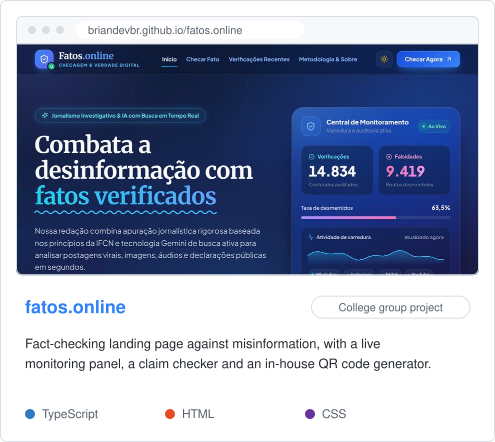
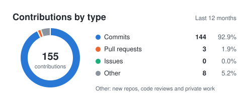

### `$ cat about.md`

> **Backend developer in training** — Node.js, Express and the terminal, one small tested module at a time.

I'm David, an 18-year-old Systems Analysis &amp; Development student in my 2nd term at **Uninassau**, in Olinda, Pernambuco. Three processes are always running here:

- **`[ BACKEND ]`** Going from JavaScript fundamentals to **Node.js and Express** through the **freeCodeCamp Full Stack** curriculum, and covering what I write with **unit tests** (Vitest).
- **`[ TERMINAL ]`** Automating my own setup: **[dotfiles](https://github.com/briandevbr/dotfiles)** is a modular terminal for beginners that runs bash, zsh and PowerShell on Linux, macOS and Windows. Daily driver: Pop!_OS.
- **`[ TEAMWORK ]`** Shipping with classmates: college projects live on the web and a full restructure of the team game **Editorial da Mentira** — small commits, clear messages, one branch per feature.

> 🎯 **Current mission:** become a solid backend developer, then grow into fullstack, with my English leveling up at PROLINFO (UPE) along the way.

### `$ ls -l ~/stack`

  

### `$ ls ~/live-projects`

<!-- showcase:start -->

  
   
  
  
   
   
  
   
  
  
   
   
  
   
  
  

<!-- showcase:end -->

### `$ stats`

  
   
  

### `$ ./snake --contributions`

### `$ contact --help`

  
  

