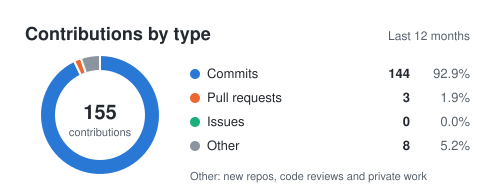

# Perfil em terminal CRT verde: plano de implementação

> **Para agentes:** SUB-SKILL OBRIGATÓRIO: use superpowers:subagent-driven-development (recomendado) ou superpowers:executing-plans para implementar tarefa por tarefa. Os passos usam checkbox (`- [ ]`).

**Objetivo:** trocar o README e o gerador atuais pelo perfil em terminal CRT verde descrito na especificação.

**Arquitetura:** o `scripts/generate-cards.mjs` vira só um orquestrador. O desenho mora em `scripts/crt/` (kit, banner, cards), os dados do GitHub em `scripts/github.mjs` e a montagem do README em `scripts/readme.mjs`. Tudo roda no workflow existente e é publicado na branch `output`.

**Stack:** Node 22 (ESM `.mjs`, sem dependências), `node:test`, GitHub Actions (Platane/snk, crazy-max/ghaction-github-pages), Python 3 só para validar XML no CI.

**Especificação:** `docs/profile-design.md`

## Restrições globais

- Sem dependências npm e sem `package.json`. Os testes rodam com `node --test scripts/test/*.test.mjs`.
- Commits com autor e committer `briandevbr <briandevbr@gmail.com>`, sem `Co-Authored-By` nem qualquer trailer de IA, com `commit.gpgsign=false` no repositório. Mensagens em português no formato `tipo(escopo): descrição`.
- Trabalho em `main` local. **Um único push para `origin main` no fim (Tarefa 10).** Estados intermediários não vão para o remoto: o workflow roda a cada push e publicaria um perfil pela metade.
- Paleta (exata): `screen #04100A`, `bezel #0F3D22`, `track #0A2416`, `deep #0E4429`, `mid #1B7A3C`, `dim #4FAE6A`, `phos #39D353`, `hot #8CFFA8`, `pale #D2FFDD`. Cobrinha: níveis `#0a1f12,#0e4429,#006d32,#26a641,#39d353`, cobra `#8cffa8`.
- Tamanhos: banner 720×276, divisor 720×14, cards 495 de largura, moldura da cobrinha 912×252, teclas 40 de altura.
- Todo SVG tem `role="img"`, `<title>`, `aria-label` e `@media (prefers-reduced-motion: reduce){*{animation:none!important}}`.
- Texto mono: `textLength = caracteres × 0,6 × tamanho`, `lengthAdjust="spacingAndGlyphs"`.
- Animações rodam uma vez. Só ficam em loop: o cursor, a piscada e a faixa do banner, o pulso do divisor e a cobrinha.
- URL dos assets: `https://raw.githubusercontent.com/briandevbr/briandevbr/output/`.
- Limites: `boot` ≤ 69 caracteres, `role` ≤ 54, item de stack ≤ 15; o nome do site em pixels não pode encostar no status.
- Os protótipos aprovados estão em `/tmp/scratchpad/banners/` (`gen.mjs`: `bannerFinal`, `divider`; `part4.mjs`: cards). Servem de ponto de partida; os valores deste plano e da especificação prevalecem.

## Pontos de atenção na revisão

1. **Texto com `&`, `<` ou aspas** no `showcase.json` ou no `profile.json`: o SVG continua XML válido. Teste na Tarefa 4.
2. **Ano sem contribuição** (total 0): a rosca vira um anel `track`, o centro mostra `0` e as porcentagens `0.0%`, nunca `NaN`. Teste na Tarefa 3.
3. **Menos de 6 linguagens, ou nenhuma:** o card ajusta a altura; sem nenhuma, mostra `No public code yet.`. Teste na Tarefa 3.
4. **Print ausente** em `assets/showcase/`: o gerador para com erro citando o caminho. Teste na Tarefa 7.
5. **Repositório sem linguagens na API:** o card do site some com a linha de linguagens, sem `·` sobrando. Teste na Tarefa 4.

---

### Tarefa 1: kit CRT

**Arquivos:**
- Criar: `scripts/crt/kit.mjs`
- Teste: `scripts/test/kit.test.mjs`

**Interfaces:**
- Produz:
  - `PALETTE` — objeto com as 9 cores das restrições globais.
  - `SNAKE = { levels: string[5], snake: string }`.
  - `snkColorParams(): string` — retorna `'color_snake=#8cffa8&color_dots=#0a1f12,#0e4429,#006d32,#26a641,#39d353'`.
  - `escapeXml(s)`.
  - `textWidth(chars, size): number`.
  - `mono(x, y, text, size, fill, attrs = ''): string` e `monoEnd(xEnd, y, text, size, fill): string`.
  - `GLYPHS` — mapa da fonte 5×7: A–Z, 0–9, `. - / : > < _` e espaço.
  - `pixelText(text, x, y, p, fill): { svg, width, height }` — converte para maiúsculas e lança `Error('Unsupported pixel character: "<c>"')` para qualquer caractere fora de `GLYPHS`. `width = (6·n − 1)·p`, `height = 7·p`.
  - `wrap(text, maxChars, maxLines): string[]` — a mesma lógica do `wrap` atual de `generate-cards.mjs`, com `…` na última linha.
  - `timeline(): { css: string[], show(start), fade(start, dur = 0.6), cursor(start), type(x, y, chars, size, start, perChar = 0.07) }` — `type` devolve o `<rect>` da capa na cor `PALETTE.screen`, com posição natural em `x + textWidth`, e empurra para `css` um `@keyframes tN{from{transform:translateX(-W px)}to{transform:translateX(0)}}` animado com `steps(chars)` e `both`.
  - `screen({ width, height, label, body, level, css = [], defs = '' }): string` — documento SVG completo. `level: 'strong' | 'light'`. Strong: scanline .38, vinheta .70, filtro `phos` com blur 2.4, mais as keyframes `flick` e `roll` disponíveis. Light: scanline .16, vinheta .45. Ambos: clip arredondado, fundo `screen`, borda `bezel` e regra de movimento reduzido.
- Partir das funções `pixelWord`, `mono`, `timeline`, `crtDefs` e `svg` de `gen.mjs` e de `pixel`, `screen` e `FONT` de `part4.mjs`.

- [ ] **Passo 1: escrever os testes que falham** (`scripts/test/kit.test.mjs`)
  - `pixelText('DAVID BRIAN', 0, 0, 10, '#fff').width === 650` e `height === 70`.
  - `pixelText('fatos.online', …)` não lança erro, porque converte para maiúsculas.
  - `pixelText('Ã', …)` lança erro com a mensagem `/Unsupported pixel character: "Ã"/`.
  - Todo caractere de `'ABCDEFGHIJKLMNOPQRSTUVWXYZ0123456789.-/:><_ '` existe em `GLYPHS` com 7 linhas de 5 colunas.
  - `mono(0, 0, 'abc', 20, '#fff')` contém `textLength="36.0"`.
  - `wrap('a b c d e f', 3, 2)` deepEquals `['a b', 'c…']`.
  - `screen({…level:'strong'})` contém `opacity=".38"`; com `'light'` contém `opacity=".16"`. Os dois contêm `role="img"`, `<title>`, `aria-label=` e `prefers-reduced-motion`.
  - Um `timeline().type(10, 50, 6, 16, 0.3)` produz `x="67.6"` e `steps(6)`, e o `css` contém `translateX(-57.6px)`.
  - `snkColorParams()` é igual à string das restrições globais.
- [ ] **Passo 2:** `node --test scripts/test/kit.test.mjs`. Esperado: FAIL (módulo inexistente).
- [ ] **Passo 3:** implementar `scripts/crt/kit.mjs` com as interfaces acima.
- [ ] **Passo 4:** `node --test scripts/test/kit.test.mjs`. Esperado: PASS.
- [ ] **Passo 5:** commit `feat(crt): kit com paleta verde, fonte em pixels e moldura CRT`

### Tarefa 2: banner e divisor

**Arquivos:**
- Criar: `scripts/crt/banner.mjs`
- Teste: `scripts/test/banner.test.mjs`

**Interfaces:**
- Consome: Tarefa 1.
- Produz:
  - `LIMITS = { boot: 69, role: 54 }`.
  - `bannerPixelSize(name): number` = `Math.min(10, 656 / (6 * name.length - 1))`.
  - `renderBanner({ name, boot, role }): string` — 720×276, nível strong, com a ordem e os tempos da especificação §5: boot em 0,2 / 0,55 / 0,9 s; o nome em 1,35 s por 0,9 s com `steps(<letras>)`; o cargo a 35 ms por caractere, 20 px, `hot`; o cursor no fim da última linha. A `aria-label` é `"<Nome Capitalizado> — <role sem '> ' unidos por ' · '>"`. Lança `Error('boot line too long (N > 69): …')` e `Error('role line too long (N > 54): …')`.
  - `renderDivider(): string` — 720×14, traço `dim` com `stroke-dasharray="8 6"` e pulso `hot` de 180 px em `run 4.5s`, em loop. O `<title>` é `Divider`.

- [ ] **Passo 1: testes que falham**
  - `bannerPixelSize('DAVID BRIAN') === 10` e `bannerPixelSize('DAVID BRIAN SILVA') < 10`.
  - `renderBanner(profile)` (o `profile.json` da especificação §7) contém o texto escapado de cada linha de boot e de cargo, `viewBox="0 0 720 276"` e `aria-label="David Brian — BACKEND DEVELOPER // NODE.JS · EXPRESS · REST APIs &#38; TERMINAL AUTOMATION"`.
  - Linha de boot com 70 caracteres lança `/boot line too long \(70 > 69\)/`; linha de cargo com 55 lança `/role line too long \(55 > 54\)/`.
  - `renderDivider()` contém `viewBox="0 0 720 14"`, `stroke-dasharray="8 6"`, `run 4.5s`, `role="img"`, `<title>Divider</title>` e `prefers-reduced-motion`.
- [ ] **Passo 2:** `node --test scripts/test/banner.test.mjs`. Esperado: FAIL.
- [ ] **Passo 3:** implementar a partir de `bannerFinal` e `divider` de `gen.mjs`.
- [ ] **Passo 4:** `node --test scripts/test/banner.test.mjs`. Esperado: PASS.
- [ ] **Passo 5:** commit `feat(crt): banner com boot, nome em pixels e cargo digitado`

### Tarefa 3: cards de stack, linguagens e contribuições

**Arquivos:**
- Criar: `scripts/crt/cards.mjs` (primeira parte)
- Teste: `scripts/test/cards.test.mjs`

**Interfaces:**
- Consome: Tarefa 1.
- Produz:
  - `STACK_ITEM_MAX = 15`.
  - `renderStack({ now, next }): string` — 495 de largura, nível light, título `STACK` e comando `$ ls ~/stack`, 3 colunas (x = 24, 180, 336). Lança `Error('stack item too long (N > 15): …')`.
  - `litBlocks(percent, max): number` = `Math.max(1, Math.round(percent / max * 20))`.
  - `renderLanguages(langs: { name, percent }[]): string` — título `LANGUAGES` e comando `$ stats --langs`, uma linha a cada 26 px a partir de y = 86, 20 blocos de 10×12 com passo de 13 a partir de x = 158, lit `phos` e trilho `track`, `%` com 1 casa em `hot`. Com a lista vazia, mostra `No public code yet.` em `dim`.
  - `renderContributions(slices: { label, value }[4]): string` — 495×232, título `CONTRIBUTIONS` e `last 12 months`. A rosca tem centro (110, 140), raio externo 62 e interno 44, cores commits `phos`, PRs `mid`, issues `pale`, other `deep`, com contorno de 2.5 na cor `screen`. O total aparece em pixels de 4 px (`hot`) com o rótulo `TOTAL`, mais a legenda com valor e `%` e a nota `Other = new repos, reviews, private`. Com menos de 2 fatias visíveis, desenha um anel cheio (cor da fatia, ou `track` quando tudo é 0).

- [ ] **Passo 1: testes que falham**
  - Item de stack com 16 caracteres lança `/stack item too long \(16 > 15\)/`.
  - `litBlocks(28, 28) === 20`, `litBlocks(10.8, 28) === 8` e `litBlocks(0.1, 28) === 1`.
  - `renderLanguages` com os 6 dados reais (Shell 28.0 … CSS 10.8) contém `28.0%` e `10.8%` e exatamente 120 ocorrências de `width="10" height="12"` (6 linhas × 20 blocos).
  - `renderLanguages([])` contém `No public code yet.`.
  - `renderContributions` com 151/3/0/8 contém `93.2%`, `1.9%`, `0.0%`, `4.9%` e `TOTAL`, com a `aria-label` começando por `Contributions by type, last 12 months: Commits 151 (93.2%)`.
  - Com tudo 0, contém `0.0%`, não contém `NaN` e desenha o anel com `stroke="#0A2416"` (cor `track`).
- [ ] **Passo 2:** `node --test scripts/test/cards.test.mjs`. Esperado: FAIL.
- [ ] **Passo 3:** implementar a partir de `stackCard`, `languagesCard` e `contributionsCard` de `part4.mjs`.
- [ ] **Passo 4:** `node --test scripts/test/cards.test.mjs`. Esperado: PASS.
- [ ] **Passo 5:** commit `feat(crt): cards de stack, linguagens e contribuições`

### Tarefa 4: card de site, teclas e moldura da cobrinha

**Arquivos:**
- Modificar: `scripts/crt/cards.mjs`
- Teste: `scripts/test/cards.test.mjs`

**Interfaces:**
- Consome: Tarefa 1.
- Produz:
  - `renderShowcase(project: { name, site, description, status, languages: string[] }, jpeg: Buffer): string` — 495×444, nível light. Tem a linha `$ open <host sem esquema nem barra final>` (13 px, `dim`); o print em x 16, y 44, 463×231.5, com `preserveAspectRatio="xMidYMid slice"`, cor real (sem filtro) e moldura `bezel`; o nome em pixels de 3 px em y = 296; o `[ STATUS EM MAIÚSCULAS ]` alinhado à direita (11 px); a descrição com `wrap(…, 52, 3)` em y = 352 + 21·i (14 px, `phos`); e as linguagens unidas por ` · ` em y = 424, omitidas se a lista estiver vazia. Lança `Error('showcase name overlaps status: <name>')` quando `24 + largura do nome + 12 > 471 − largura do status`.
  - `KEYS = { site: '> LIVE SITE', repo: '</> SOURCE', linkedin: '> LINKEDIN', email: '> EMAIL' }`.
  - `renderKey(kind): string` — 40 de altura, pixels de 2 px. `site` aceso (fundo `phos`, texto `screen`, borda `hot`); os outros apagados (fundo `screen`, texto `phos`, borda `bezel`). `kind` desconhecido lança erro.
  - `wrapSnake(snakeSvg: string): string` — moldura 912×252 de nível light com `$ ./snake --contributions`. A raiz do SVG do snk vira `<svg x="16" y="44" width="880" height="192" viewBox="<original>">`, e o `<desc>` é removido. Lança `Error('snake SVG without viewBox')`.

- [ ] **Passo 1: testes que falham**
  - `renderShowcase` (Pizzaria3Irmaos, status `Local business site`) contém `$ open briandevbr.github.io/Pizzaria3Irmaos`, `data:image/jpeg;base64,` e `xMidYMid slice`, e não contém `feColorMatrix`.
  - Um nome de 21 caracteres com status `College group project` lança `/showcase name overlaps status/`.
  - Uma descrição `'A & B <C> "D"'` gera XML válido: verificar que o texto escapado `A &#38; B &#60;C&#62;` está presente e que não existe `& ` cru.
  - Com `languages: []`, o SVG não contém ` · ` nem linha vazia de linguagens em y = 424.
  - `renderKey('site')` contém `fill="#39D353"`; `renderKey('email')` contém `role="img"`, `<title>` e `prefers-reduced-motion`; `renderKey('nope')` lança erro.
  - `wrapSnake('<svg viewBox="-16 -32 880 192" width="880" height="192" xmlns="http://www.w3.org/2000/svg"><desc>Generated with https://github.com/Platane/snk</desc><style>:root{--cs:#8cffa8}</style><rect class="c" width="12" height="12"/></svg>')` contém `<svg x="16" y="44" width="880" height="192" viewBox="-16 -32 880 192">` e `:root{--cs:#8cffa8}`, e não contém `<image` nem `<desc>`.
  - `wrapSnake('<svg></svg>')` lança `/without viewBox/`.
- [ ] **Passo 2:** `node --test scripts/test/cards.test.mjs`. Esperado: FAIL nos testes novos.
- [ ] **Passo 3:** implementar a partir de `showcaseCard` (sem a opção `tint`), `key` e `snakeFrame` de `part4.mjs`. Em `wrapSnake` não há recoloração, porque as cores vêm do snk.
- [ ] **Passo 4:** `node --test scripts/test/cards.test.mjs`. Esperado: PASS.
- [ ] **Passo 5:** commit `feat(crt): card de site no ar, teclas e moldura da cobrinha`

### Tarefa 5: dados do GitHub

**Arquivos:**
- Criar: `scripts/github.mjs`
- Teste: `scripts/test/github.test.mjs`

**Interfaces:**
- Produz (código movido de `generate-cards.mjs`, mesma lógica):
  - `graphql(query, variables, token)`.
  - `fetchUser(login, token)` — a query pede `repositories(ownerAffiliations: OWNER, isFork: false, privacy: PUBLIC, first: 100) { nodes { languages(first: 10, orderBy: {field: SIZE, direction: DESC}) { edges { size node { name color } } } } }` e `contributionsCollection { totalCommitContributions totalPullRequestContributions totalIssueContributions contributionCalendar { totalContributions } }`; sai `name`, `followers`, `createdAt` e `totalCount`.
  - `fetchRepo(entry, login, token): { slug, name, url, description, status, site, languages: string[] }` — `slug` = `<owner>-<name>`; `languages` traz até 3 nomes; a descrição vem da entrada e, se faltar, do repositório.
  - `topLanguages(repos, limit = 6): { name, percent }[]` e `contributionBreakdown(collection): { label, value }[4]`, com a mesma lógica de hoje.

- [ ] **Passo 1: testes que falham** (`globalThis.fetch` substituído por um stub que devolve `{ ok: true, json: async () => ({ data }) }`)
  - `contributionBreakdown` com 151/3/0 e total 162 dá deepEquals `[Commits 151, Pull requests 3, Issues 0, Other 8]`; com total 150 e soma 154, `Other` é 0.
  - `topLanguages` com 2 repositórios de exemplo devolve no máximo 6 itens, em ordem decrescente, com as porcentagens somando 100 (±0,01).
  - `fetchRepo({ repo: 'fatos.online', site, status }, 'briandevbr', 't')` dá `slug === 'briandevbr-fatos.online'` e `languages` com no máximo 3 itens; `{ repo: 'owner/x' }` usa `owner`; um `repository: null` lança `/Repository not found: briandevbr\/nope/`.
- [ ] **Passo 2:** `node --test scripts/test/github.test.mjs`. Esperado: FAIL.
- [ ] **Passo 3:** implementar movendo o código de `generate-cards.mjs`.
- [ ] **Passo 4:** `node --test scripts/test/github.test.mjs`. Esperado: PASS.
- [ ] **Passo 5:** commit `refactor(scripts): separa as consultas ao GitHub`

### Tarefa 6: bloco gerado do README

**Arquivos:**
- Criar: `scripts/readme.mjs`
- Teste: `scripts/test/readme.test.mjs`

**Interfaces:**
- Produz:
  - `replaceBetweenMarkers(readme, name, content)` — igual ao atual.
  - `renderShowcaseSection(projects, assetsUrl): string` — formato exato:

```html
<div align="center">
  <a href="SITE"></a>
  <br />
  <a href="SITE"></a>
  <a href="URL"></a>
</div>
```

  Com vários projetos, os blocos de `<a>` ficam no mesmo `div`, separados por `  <br />\n  <br />`. Os textos dos `alt` passam por `escapeXml`.

- [ ] **Passo 1: testes que falham**
  - Com um projeto, a saída é exatamente o bloco acima, com os valores substituídos.
  - Aplicar `replaceBetweenMarkers` duas vezes dá o mesmo texto.
  - Marcador ausente lança `/missing the showcase markers/`.
- [ ] **Passo 2:** `node --test scripts/test/readme.test.mjs`. Esperado: FAIL.
- [ ] **Passo 3:** implementar.
- [ ] **Passo 4:** `node --test scripts/test/readme.test.mjs`. Esperado: PASS.
- [ ] **Passo 5:** commit `feat(readme): bloco live-projects com cards CRT e teclas`

### Tarefa 7: orquestrador, `profile.json` e limpeza

**Arquivos:**
- Reescrever: `scripts/generate-cards.mjs`
- Criar: `profile.json` (conteúdo exato da especificação §7)
- Apagar: `projects.json`
- Teste: `scripts/test/generate.test.mjs`

**Interfaces:**
- Consome: Tarefas 1 a 6.
- Produz: `main({ cwd = process.cwd(), env = process.env } = {})`, que:
  - lê `profile.json`, `showcase.json`, cada `preview` e `dist/snake-raw.svg`;
  - grava em `<cwd>/dist/`: `banner.svg`, `divider.svg`, `stack.svg`, `languages.svg`, `contributions.svg`, `key-{site,repo,linkedin,email}.svg`, `showcase-<slug>.svg` (um por site) e `snake.svg`;
  - apaga `dist/snake-raw.svg`;
  - reescreve só o bloco `showcase` do `README.md`.
- URL dos assets: `https://raw.githubusercontent.com/${env.GITHUB_REPOSITORY ?? `${login}/${login}`}/output`; sem `GITHUB_USER` ou `GITHUB_TOKEN`, lança erro, como hoje.
- Um `preview` ausente lança `Error('Missing preview: <caminho>')`; `dist/snake-raw.svg` ausente lança `Error('Missing dist/snake-raw.svg (run Platane/snk first)')`.
- O arquivo continua executável com `node scripts/generate-cards.mjs`.

- [ ] **Passo 1: teste que falha.** Num diretório temporário com `profile.json`, um `showcase.json` de 1 site, um JPEG de 2 bytes, um `README.md` com os marcadores e um `dist/snake-raw.svg` de exemplo, e com `fetch` substituído por um stub:
  - a lista ordenada de `dist/` é exatamente `banner.svg, contributions.svg, divider.svg, key-email.svg, key-linkedin.svg, key-repo.svg, key-site.svg, languages.svg, showcase-briandevbr-OrganizeMe.svg, snake.svg, stack.svg`;
  - o `README.md` contém `showcase-briandevbr-OrganizeMe.svg`;
  - todo arquivo de `dist/` contém `role="img"`, `<title>` e `prefers-reduced-motion`;
  - rodar de novo deixa o `README.md` idêntico;
  - sem o JPEG, lança `/Missing preview: .*organizeme.jpg/`.
- [ ] **Passo 2:** `node --test scripts/test/generate.test.mjs`. Esperado: FAIL.
- [ ] **Passo 3:** reescrever o `generate-cards.mjs` como orquestrador. Remover `renderOverview`, `renderProjectCard`, `renderProjectsSection`, os cards e botões antigos e o `THEMES`. Criar o `profile.json` e apagar o `projects.json`.
- [ ] **Passo 4:** `node --test scripts/test/*.test.mjs`. Esperado: tudo PASS.
- [ ] **Passo 5:** commit `feat(scripts): orquestrador do perfil CRT e profile.json`

### Tarefa 8: README novo

**Arquivos:**
- Reescrever: `README.md`

O conteúdo é exato. O bloco `showcase` entra vazio e é preenchido na Tarefa 10 com a saída do gerador.

````markdown



### `$ cat about.md`

18-year-old Systems Analysis &amp; Development student (2nd term at Uninassau, Olinda, PE). I study every day and publish what I build: small, tested and explainable code.

- Going through the **freeCodeCamp Full Stack** curriculum and covering small modules with **unit tests** (Vitest)
- Practicing a real Git workflow: small commits, clear messages, one branch per feature
- Daily driver: Pop!_OS + bash · English in progress at PROLINFO (UPE)
- Goal: become a solid backend developer, then grow into fullstack


### `$ ls ~/stack`

<div align="center">
  
</div>


### `$ ls ~/live-projects`

<!-- showcase:start -->
<!-- showcase:end -->


### `$ stats`

<div align="center">
  
  <br />
  
</div>


### `$ ./snake --contributions`




### `$ contact --help`

<p align="center">
  <a href="https://www.linkedin.com/in/david-brian-95b977425/"></a>
  <a href="mailto:mr.brian154@gmail.com"></a>
</p>
````

- [ ] **Passo 1:** escrever o `README.md` acima.
- [ ] **Passo 2:** `grep -c 'output/' README.md` dá 13 e `grep -cE 'streak|skillicons|readme-typing|projects:start' README.md` dá 0.
- [ ] **Passo 3:** commit `feat(readme): perfil novo em terminal CRT verde`

### Tarefa 9: workflow

**Arquivos:**
- Modificar: `.github/workflows/snake.yml`
- Teste: `scripts/test/workflow.test.mjs`

Nova ordem dos passos, mantendo os gatilhos e as permissões:

1. `actions/checkout@v4`
2. `run: node --test scripts/test/*.test.mjs`
3. `Platane/snk@v3` com `outputs: dist/snake-raw.svg?<snkColorParams()>`
4. `node scripts/generate-cards.mjs` (env `GITHUB_USER` e `GITHUB_TOKEN`, como hoje)
5. `run: python3 -c "import glob,sys,xml.etree.ElementTree as E; fs=glob.glob('dist/*.svg'); [E.parse(f) for f in fs]; print(len(fs),'SVGs ok')"`
6. `crazy-max/ghaction-github-pages@v4` com `author` e `committer` `briandevbr <briandevbr@gmail.com>`, como hoje
7. O commit do README igual ao atual, com a mensagem `chore(readme): atualiza as seções geradas`

- [ ] **Passo 1: teste que falha** — lê o YAML como texto e confere:
  - que contém `dist/snake-raw.svg?` seguido de `snkColorParams()`;
  - que `node --test` aparece antes de `Platane/snk`, que aparece antes de `generate-cards.mjs`, que aparece antes de `xml.etree`, que aparece antes de `ghaction-github-pages`;
  - que `github-actions[bot]` não aparece.
- [ ] **Passo 2:** `node --test scripts/test/workflow.test.mjs`. Esperado: FAIL.
- [ ] **Passo 3:** editar o `snake.yml`.
- [ ] **Passo 4:** `node --test scripts/test/*.test.mjs`. Esperado: tudo PASS.
- [ ] **Passo 5:** commit `ci(workflow): testes, cobrinha verde e validação dos SVGs`

### Tarefa 10: verificação ponta a ponta e push

- [ ] **Passo 1: ensaio local.** Copiar o repositório para um diretório temporário, gerar `dist/snake-raw.svg` a partir do `github-snake-dark.svg` atual da branch `output` (só como amostra) e rodar `MOCK_BREAKDOWN='[151,3,0,162]' GITHUB_USER=briandevbr GITHUB_TOKEN=x node --import /tmp/scratchpad/mock-fetch.mjs scripts/generate-cards.mjs` (o mock devolve a API simulada; as linguagens dele são ilustrativas). Esperado: 13 SVGs, todos XML válidos.
- [ ] **Passo 2:** levar o bloco `showcase` gerado para o `README.md` do repositório e confirmar que uma segunda execução não muda o arquivo.
- [ ] **Passo 3: prints.** Renderizar o README com `marked` e `github-markdown-css`, servindo os SVGs do `dist/` local, em 1280 px e 390 px, nos temas claro e escuro. Esperado: rolagem lateral 0, nenhuma imagem quebrada e a animação final igual aos rascunhos aprovados.
- [ ] **Passo 4:** `node --test scripts/test/*.test.mjs` com tudo PASS. `git log origin/main..main --format='%an <%ae>|%cn <%ce>|%B'` mostra só `briandevbr` e nenhum trailer.
- [ ] **Passo 5:** commit `docs(readme): bloco live-projects gerado` (se o Passo 2 mudou o README), depois `git push origin main`.
- [ ] **Passo 6:** acompanhar o run do workflow. Esperado: verde. A branch `output` passa a ter exatamente os 13 SVGs da Tarefa 7, o commit dela é de `briandevbr` e a `main` não recebe commit do bot. Conferir os números reais no `<title>` de `contributions.svg` e `languages.svg`.
